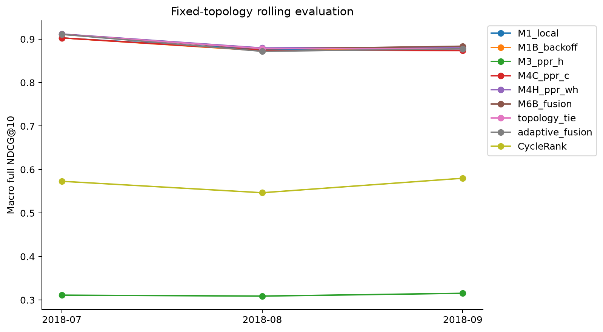
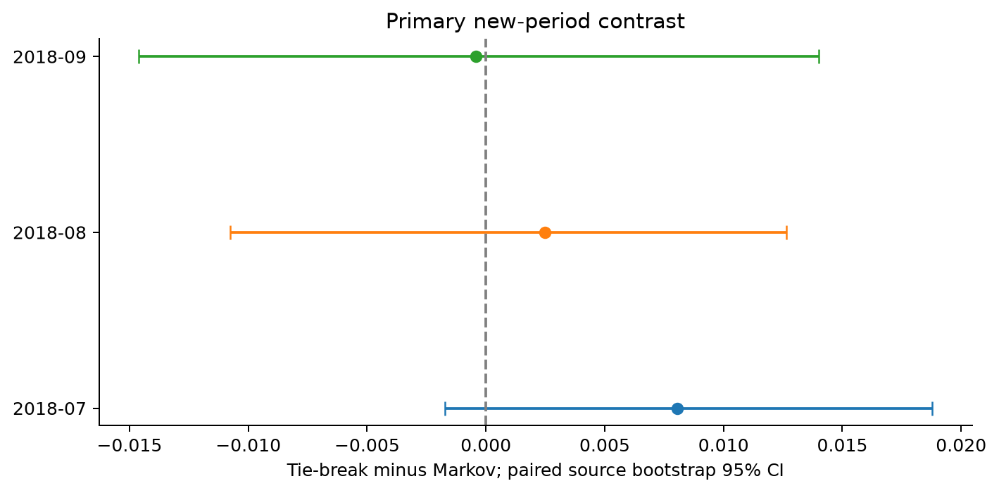
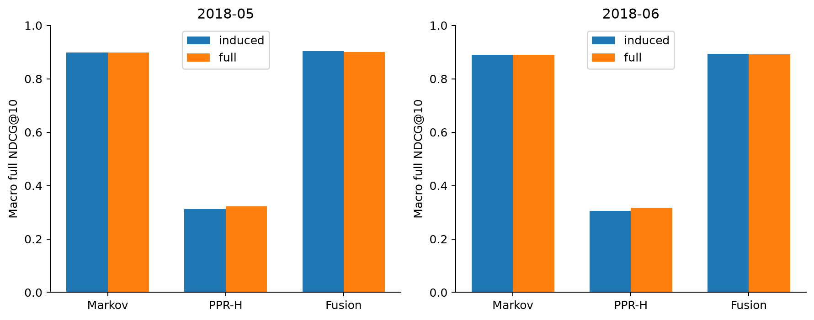
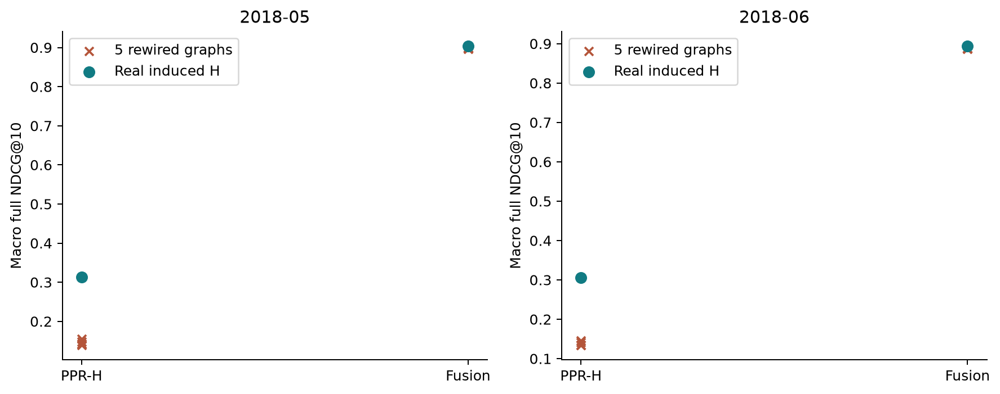
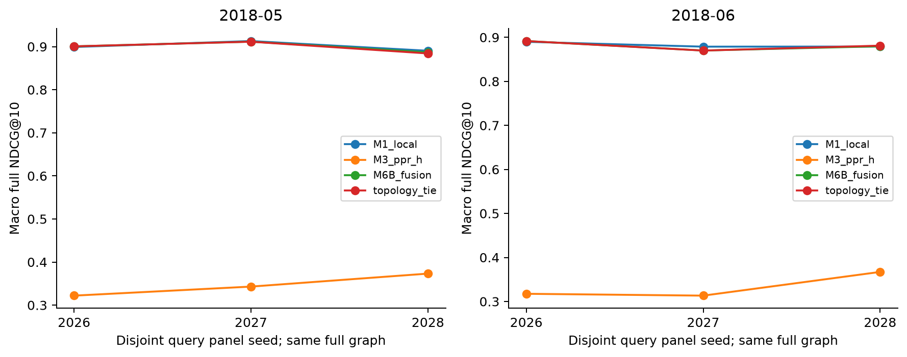
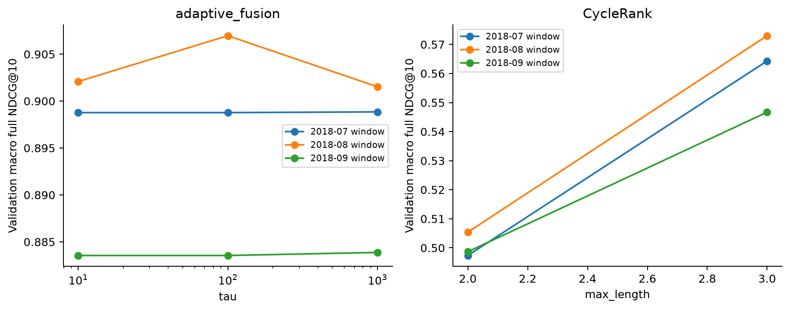
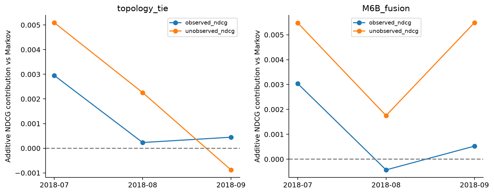

# Kết quả mở rộng: kiểm tra cấu trúc, thời gian và cơ chế

Bổ sung ngày 22/10/2026. Original `study-v3` giữ nguyên. Extension run `extensions-v2` hoàn thành; bản `extensions-v1` dừng do lỗi SQL alias trước khi đọc July test. Đây là empirical comparative study, không survey thuần và không đề xuất thuật toán mới.

## 1. Câu trả lời chính

Historical local frequency vẫn là baseline mạnh. Mở graph đến toàn bộ historical canonical inventory không làm PPR-H vượt Markov trên các query panels được chọn. Cấu trúc liên kết thật có ích hơn các graph giữ degree nhưng đã hoán đổi cạnh; tuy vậy, “topology có thông tin” không đồng nghĩa “thêm topology sẽ cải thiện một baseline behavior mạnh”. Primary contrast tie-break−Markov trên ba tháng mới chưa có interval nào loại trừ 0.

Phần mới hoàn thành mọi nhóm thí nghiệm của quality plan: full-graph boundary, ba rolling windows, topology tie-break, năm degree-preserving perturbations, hai query panels bổ sung, bounded CycleRank và adaptive fusion. Không tăng số model để thay thế việc giải thích kết quả.

## 2. Protocol, dữ liệu và phạm vi kết luận

H/redirects cố định tại 01/03/2018. W1 train Mar–May/validation June/test July; W2 train Apr–June/validation July/test August; W3 train May–July/validation August/test September. Protocol và grids khóa trước khi parse July–September labels. Từng window lưu predictions + SHA256 trước test read; previous test trở thành future validation theo chronology đã định. Không chọn best-test seed hoặc thay grid sau W1.

Ba archives mới tải từ Your.org mirror được Wikimedia infrastructure tracker ghi nhận; origin trả 403. Bytes và local SHA256 đã lưu/pin, không gọi chúng là publisher-issued checksums. Schema/mapping audits đi cùng từng tháng. [Nguồn mirror](https://phabricator.wikimedia.org/T415193).

Boundary/null/panels dùng May–June đã xem nên là exploratory. July–September là new-period confirmation theo protocol mới, không phải external preregistration. Full H có **2.077.467 canonical nodes, 36.333.722 edges**; rolling/CycleRank/Node2Vec vẫn dùng original induced context **8.094 nodes, 319.694 edges**. Full-graph processing không biến 200/600 sampled queries thành population benchmark.

Models rolling: 13 configurations trước embeddings, cộng 2 embedding graph variants × 3 seeds = 19 configurations mỗi window. Đây không phải 19 thuật toán độc lập. Same candidate sets, full/conditional denominators, macro/traffic weighting và log-gain NDCG giữ nguyên.

## 3. Rolling results và primary contrast

| Configuration | July NDCG | August NDCG | September NDCG |
| --- | --- | --- | --- |
| M0_global | 0.1866 | 0.1865 | 0.2036 |
| M1_local | 0.9027 | 0.8758 | 0.8776 |
| M1B_backoff | 0.9027 | 0.8731 | 0.8776 |
| M2_uniform | 0.2460 | 0.2400 | 0.2365 |
| M2D_indegree | 0.1268 | 0.1268 | 0.1397 |
| M3_ppr_h | 0.3112 | 0.3090 | 0.3154 |
| M4C_ppr_c | 0.9027 | 0.8739 | 0.8735 |
| M4H_ppr_wh | 0.9117 | 0.8796 | 0.8816 |
| M6B_fusion | 0.9112 | 0.8771 | 0.8837 |
| topology_tie | 0.9107 | 0.8783 | 0.8772 |
| adaptive_fusion | 0.9108 | 0.8718 | 0.8776 |
| CycleRank | 0.5730 | 0.5467 | 0.5800 |
| HITS | 0.1312 | 0.1354 | 0.1464 |

Tất cả số trong bảng là macro full NDCG@10 trên observable sources. Không thay N/A bằng 0. Required Recall@5/10/20, MRR@10, NDCG@10 và traffic-weighted/conditional variants có trong CSV đầy đủ.

| Test | Observable / 200 | Pair coverage | Click-mass coverage | Tie−Markov Δ | Paired 95% CI |
| --- | --- | --- | --- | --- | --- |
| 2018-07 | 128 | 0.9239 | 0.9623 | 0.008043 | [-0.001737, 0.018784] |
| 2018-08 | 127 | 0.9140 | 0.9558 | 0.002490 | [-0.010756, 0.012657] |
| 2018-09 | 124 | 0.9181 | 0.9518 | -0.000432 | [-0.014616, 0.013998] |

Cả ba CI chứa 0: chưa có reliable improvement của topology tie-break trên từng window; đây cũng không phải kiểm định equivalence. Primary comparator là unsmoothed M1_local. Secondary contrasts so M1B_backoff; hai baseline khác nhau trong August nên không trộn các delta này. Overlapping windows/source reuse không phải independent replications; không gộp 379 nguồn-tháng thành 379 người dùng độc lập. Có **115 sources** có observable labels ở cả ba tháng, báo riêng trong common-source table.

| Model | July weighted NDCG | August weighted NDCG | September weighted NDCG |
| --- | --- | --- | --- |
| M1_local | 0.9616 | 0.9558 | 0.9470 |
| M1B_backoff | 0.9616 | 0.9539 | 0.9470 |
| M4H_ppr_wh | 0.9598 | 0.9551 | 0.9304 |
| M6B_fusion | 0.9622 | 0.9557 | 0.9330 |
| topology_tie | 0.9622 | 0.9555 | 0.9327 |
| adaptive_fusion | 0.9622 | 0.9547 | 0.9328 |

## 4. Graph boundary: thay context, giữ candidates và knobs

| Model | May induced | May full | June induced | June full |
| --- | --- | --- | --- | --- |
| M1_local | 0.8991 | 0.8991 | 0.8899 | 0.8899 |
| M3_ppr_h | 0.3126 | 0.3220 | 0.3055 | 0.3174 |
| M4C_ppr_c | 0.9018 | 0.9039 | 0.8899 | 0.8920 |
| M4H_ppr_wh | 0.9039 | 0.9090 | 0.8914 | 0.8937 |
| M6B_fusion | 0.9034 | 0.9006 | 0.8936 | 0.8916 |
| topology_tie | 0.9034 | 0.9007 | 0.8929 | 0.8916 |
| adaptive_fusion | 0.9034 | 0.9006 | 0.8929 | 0.8925 |

PPR-H tăng 0,00939 May và 0,01195 June khi mở context, nhưng paired CIs đều chứa 0. Markov giữ nguyên chính xác; fusion giảm nhẹ. Full-H PPR còn xa Markov, nên boundary loss không đủ giải thích khoảng cách trên sample này. Chỉ kiểm tra H damping0,15 và fixed fusionλ0,5, không chứng minh mọi PPR hyperparameter hoặc mọi query population đều kém. C/WH full-context cũng giữ damping0,15. Adaptiveτ chọn April riêng từng context, vì vậy adaptive row là so system-level, không pure context-only control.

Pilot không dùng labels: 10 hash-selected original queries, projected200-query solve109,09s và peakRSS1,38GiB, qua gate8GiB/30min. Full H CSR uint8 chiếm189.978.482bytes; đây là storage của một matrix, không process RSS. Whole boundary stage435,82s/maxRSS2,20GiB; rolling385,53s/1,77GiB; null74,26s/1,55GiB. Các stages chạy đồng thời trên macOS arm64 nên wall times không là isolated latency benchmark; không gồm downloads, native build hoặc report.

## 5. Degree-preserving topology control

Mỗi seed101–105 hoàn thành1.549.180 accepted directed double-edge swaps; giữ mọi in/out-degree, query outgoing candidates và node IDs, cấm duplicates/self-loops. Edge overlap còn khoảng13,3–13,4%. Degree/candidate invariants được assert; không suy finite swaps đã tạo uniform/mixed equilibrium distribution.

| Month | Model | Real induced H | Null min | Null max |
| --- | --- | --- | --- | --- |
| 2018-05 | M3_ppr_h | 0.3126 | 0.1394 | 0.1551 |
| 2018-05 | M6B_fusion | 0.9034 | 0.8967 | 0.8988 |
| 2018-06 | M3_ppr_h | 0.3055 | 0.1345 | 0.1463 |
| 2018-06 | M6B_fusion | 0.8936 | 0.8872 | 0.8887 |

Real H cao hơn cả năm rewired draws trong các hàng này. Kết quả hỗ trợ vai trò của wiring beyond degree đối với PPR; không phải causal effect của hyperlinks lên hành vi người dùng, cũng không formal permutation p-value. Fusion trên null không vượt Markov: chỉ thêm graph-shaped noise không tái tạo gain nhỏ của real topology.

## 6. Query-panel sensitivity và cold labels

Hai panels2027/2028 lấy disjoint với panel2026, mỗi panel50 nguồn trong mỗi train-defined traffic stratum. Context đều là cùng full H; chọn nguồn chỉ từ historical/training information. Không thay nguồn vắng test labels bằng nguồn có nhãn.

| Month | Panel | Observable/200 | Cold observable/50 | Markov | PPR-H | Fusion |
| --- | --- | --- | --- | --- | --- | --- |
| 2018-05 | 2026 | 127 | 0 | 0.8991 | 0.3220 | 0.9006 |
| 2018-05 | 2027 | 127 | 0 | 0.9130 | 0.3430 | 0.9115 |
| 2018-05 | 2028 | 131 | 1 | 0.8904 | 0.3731 | 0.8869 |
| 2018-06 | 2026 | 122 | 1 | 0.8899 | 0.3174 | 0.8916 |
| 2018-06 | 2027 | 129 | 0 | 0.8789 | 0.3133 | 0.8701 |
| 2018-06 | 2028 | 122 | 1 | 0.8791 | 0.3671 | 0.8797 |

Mức PPR thay đổi theo sample, nhưng trong cả sáu panel-month comparisons Markov vẫn cao hơn PPR-H. Đây là sensitivity evidence, không confidence interval cho toàn Wikipedia. Cold-start vẫn quá ít observable labels để khẳng định hiệu quả.

## 7. CycleRank, adaptive fusion và embedding stability

CycleRank implementation đếm exact simple directed cycles qua source, chỉ length2/3, cộng exp(−length) cho nodes trên cycle; không gọi đây là unrestricted CycleRank. Validation chọn k3 ở cả ba windows. Nó cao hơn PPR-H khoảng0,24–0,26 NDCG nhưng vẫn kém Markov rõ rệt. Thiết kế bám [CycleRank, or There and Back Again](https://pmc.ncbi.nlm.nih.gov/articles/PMC7544349/); không chuyển benchmark claims của paper sang đồ án.

Adaptive fusion dùng λ(u)=Neligible/(Neligible+τ), τ chọn validation trong10/100/1000. Nó không thắng đều: August thấp hơn cả local và selected backoff. Published count mass chỉ là confidence proxy bị censorship, không độ chắc chắn được hiệu chuẩn. Không tiếp tục thử τ trên test để sửa thất bại này.

| Test | Embedding graph | Mean NDCG (3seeds) | Sample SD | Min | Max |
| --- | --- | --- | --- | --- | --- |
| 2018-07 | H | 0.4397 | 0.0135 | 0.4295 | 0.4550 |
| 2018-07 | WH | 0.6742 | 0.0087 | 0.6645 | 0.6814 |
| 2018-08 | H | 0.4245 | 0.0129 | 0.4135 | 0.4387 |
| 2018-08 | WH | 0.6485 | 0.0047 | 0.6435 | 0.6528 |
| 2018-09 | H | 0.4274 | 0.0163 | 0.4136 | 0.4454 |
| 2018-09 | WH | 0.6659 | 0.0155 | 0.6526 | 0.6829 |

H dimension32, WH dimension64 dùng knobs đã chọn trong study gốc. Vì architectures khác, bảng rolling không là matched-knob causal weighting ablation; matched A5 của study-v3 mới giữ knobs bằng nhau. Không chọn seed cao nhất và không gọi ba seeds là CI về human behavior. Loss/convergence diagnostics từng configuration được lưu; không tạo giả training loss cho PPR hoặc Markov.

## 8. Cơ chế: bảo toàn count order có đủ không?

Tie-break giữ mọi unequal local-count order; topology chỉ phá equal-count ties. Trong toàn bộ600 query-months, audit Top-20 không thấy count-order inversion của tie-break. Positive future targets được phân observed/unobserved theo từng training window; hai phần DCG dùng cùng full IDCG nên cộng đúng thành NDCG, không cộng hai metric với mẫu số khác nhau.

July tie-break−Markov gồm +0,002951 từ training-observed và +0,005092 từ training-unobserved targets. September phần unobserved là−0,000879, lấn át +0,000447 observed; không thể kết luận topology luôn cứu tail. PPR-H có thêm một ít unobserved contribution nhưng mất nhiều observed contribution. Đây là evidence cho trade-off, không causal attribution hoặc reliable-negative classification. Các component CIs là exploratory, không lấy một interval thuận lợi giữa nhiều contrasts làm main discovery.

## 9. Reproducibility, demo và điều chưa chứng minh

[Portable evidence](extensions/study-v2/bundle_manifest.json) lưu5 gzip JSON payloads, frozen scores/rankings/labels, original prediction hashes và chronology logs. Standard-library verifier tính lại28.600 source×model×period evaluations, kiểm tra19.600 rankings và3.600 model views của [demo rolling](extensions/study-v2/demo.html). Totals có những query/model lặp lại giữa panel/control tables; không phải sample size nghiên cứu. Đây là re-evaluation, không retraining từ raw.86 tests đạt cục bộ; CI kiểm tra core/scientific contracts và cả hai bundles.

Demo mới cho đổi source/tháng/model để thấy refit theo thời gian; demo gốc May/June giữ predictions cố định. Cả hai hiển thị future labels như evidence, không input. Browser interaction/rendering QA vẫn chưa thực hiện được do origin access từng bị từ chối; không coi data/JS syntax checks là browser QA. Có case tables tĩnh làm fallback.

Giới hạn: no sessions/users; censored labels; exposure bias; snapshot cũ dần; 200 sources cho rolling,600 cho panel controls; source-bootstrap chỉ là approximation vì graph dependence; overlapping periods; null chưa có mixing theorem; không population/causal/online/cross-language claims. Full model reproduction trên Linux chưa được chứng nhận, dù tiny scientific CI có kiểm tra native backend.

Chạy `sh scripts/reproduce_extensions.sh` để tái tạo vào output mới. Kiểm tra nhanh: `PYTHONPATH=src python3 -m wikinav.verify_extensions`.

## 10. Evidence index

| Artifact | Câu hỏi kiểm tra |
| --- | --- |
| [metrics.csv](extensions/study-v2/tables/metrics.csv) | Toàn bộ required metrics / macro-weighted / full-conditional |
| [coverage.csv](extensions/study-v2/tables/coverage.csv) | Mẫu số, label mass/pairs và discarded coverage |
| [contrasts.csv](extensions/study-v2/tables/contrasts.csv) | Effect sizes và paired source intervals |
| [selected_parameters.csv](extensions/study-v2/tables/selected_parameters.csv) | Knobs chọn bằng validation |
| [validation_trials.csv](extensions/study-v2/tables/validation_trials.csv) | Tất cả tried settings và measured fit/score cost |
| [panel_strata.csv](extensions/study-v2/tables/panel_strata.csv) | Số nguồn có nhãn ở từng panel/traffic stratum |
| [common_sources.csv](extensions/study-v2/tables/common_sources.csv) | 115 sources chung, tránh đổi cohort ngầm |
| [embedding_seeds.csv](extensions/study-v2/tables/embedding_seeds.csv) | Variability, không best-test seed |
| [source_mechanism.csv](extensions/study-v2/tables/source_mechanism.csv) | Per-source additive contribution và count-order audit |
| [mechanism_summary.csv](extensions/study-v2/tables/mechanism_summary.csv) | Observed/unobserved deltas và exploratory CIs |

## 11. Fallback-policy audit (post-hoc)

Tie-break chỉ là thay tie policy khi source có published eligible count. Nếu source không có count eligible, M1_local dùng global-popularity fallback, còn topology_tie và adaptive dùng PPR. Vì vậy primary contrast gồm cả fallback-policy change ở nhóm này; không gán toàn bộ delta cho equal-count tie breaking.

| Test | Train eligible mass | Queries | Observable | Tie−local Δ | 95% CI |
| --- | --- | --- | --- | --- | --- |
| 2018-07 | positive_eligible_mass | 142 | 126 | 0.008561 | [-0.000914, 0.019378] |
| 2018-07 | zero_eligible_mass | 58 | 2 | -0.024553 | [-0.049105, 0.000000] |
| 2018-08 | positive_eligible_mass | 137 | 124 | 0.007128 | [0.000273, 0.015101] |
| 2018-08 | zero_eligible_mass | 63 | 3 | -0.189249 | [-0.567748, 0.000000] |
| 2018-09 | positive_eligible_mass | 136 | 121 | 0.006078 | [-0.004012, 0.017836] |
| 2018-09 | zero_eligible_mass | 64 | 3 | -0.263022 | [-0.500000, 0.000000] |

Nhóm này định nghĩa từ counts training của mỗi window, không đồng nhất với original Jan–March cold stratum. Subgroup được thêm sau test để giải thích, không trở thành primary contrast mới. Nhóm quá nhỏ không cho cold-start conclusion.
