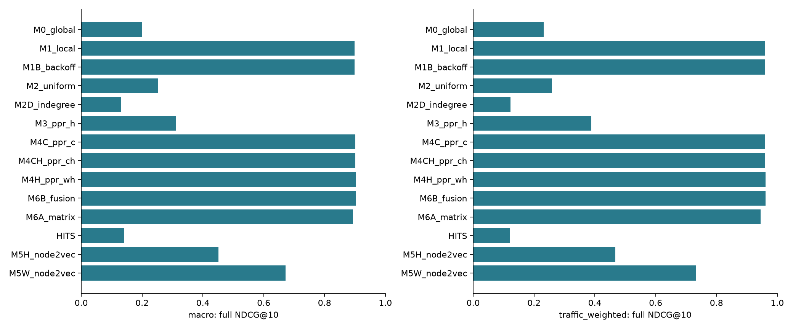
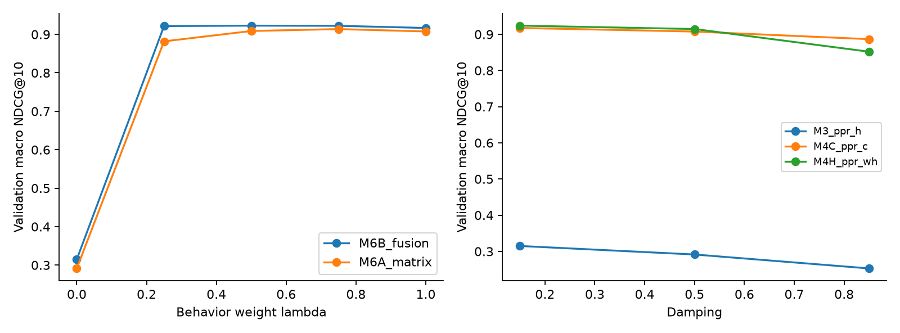
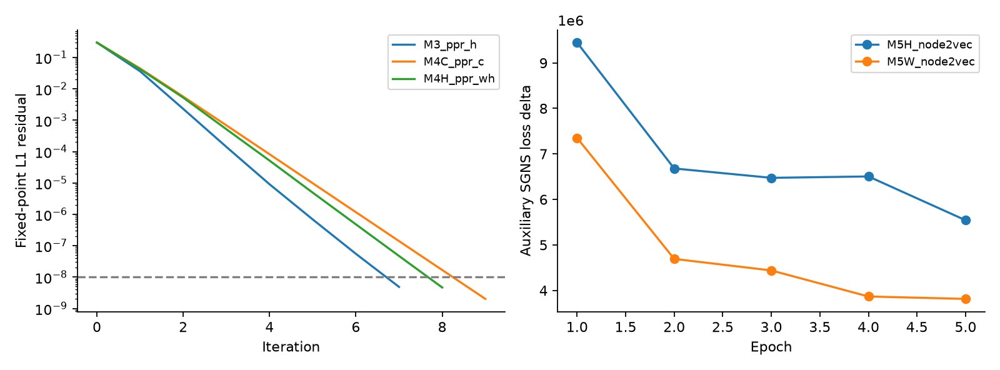

# Topology-Aware Next-Article Ranking on Wikipedia

**A Temporal Comparison of Click Frequency and Historical Hyperlink Structure**  
Báo cáo thực nghiệm học phần — study gốc ngày 21/10/2026, bổ sung ngày 22/10/2026. Dataset: eswiki 2018. Original run: `study-v3`; extension: `extensions-v2`.

Phần 1–17 trình bày study gốc, với giới hạn được cập nhật khi có evidence mới. Xem [EXTENSION_RESULTS](EXTENSION_RESULTS.md) và phần 18 cho full-graph/rolling/null/panel experiments; không trộn hai protocol thành một lần test.

Bố cục lập luận:

- Định nghĩa ranking từ một source article và giới hạn của aggregate counts.
- Xây dựng graph độc lập, khóa candidates và chronology trước test.
- So sánh frequency, topology, weighted walks và hai cách fusion.
- Đánh giá trên observable labels, kèm coverage, uncertainty và cost.
- Giải thích gain/failure bằng sparsity, boundary loss và case studies.
- Đóng góp framework tái lập; không tuyên bố thuật toán mới hoặc personalization người dùng.

## 1. Abstract

Historical click frequency là tín hiệu mạnh cho source-conditioned next-article ranking trong nghiên cứu này. Chúng tôi so sánh 14 model chính trên Clickstream Wikipedia tiếng Tây Ban Nha, training tháng 01–03/2018, validation tháng 04 và held-out tháng 05–06. Hyperlink topology lấy độc lập từ snapshot 01/03/2018; mẫu có 200 source queries, 8.094 nodes và 319.694 directed edges. Mọi model xếp hạng cùng outgoing candidates. Trên 127 nguồn có nhãn quan sát được trong tháng 05, Markov đạt macro full NDCG@10 **0,8991**, PPR-H **0,3126**, và score fusion **0,9034**. Chênh fusion–Markov **0,00429**, paired source bootstrap 95% CI **[−0,00076; 0,01035]**, chưa chứng minh improvement đáng tin cậy. Weighted Node2Vec tốt hơn unweighted khi giữ cùng knobs, nhưng vẫn kém Markov. Topology hữu ích trong một số transitions chưa có count training; lợi ích đó không chuyển thành gain tổng thể chắc chắn. Kết luận giới hạn ở historical induced sample và published, censored labels; không suy ra online CTR, user personalization hoặc full-Wikipedia performance.

Extension khóa protocol trước July–September labels và đánh giá thêm ba rolling windows. Topology tie-break−Markov có Δ0,00804/0,00249/−0,00043, cả ba source-bootstrap CI chứa0. Full-H PPR trên 36.333.722 edges vẫn kém Markov ở sampled queries; real H cao hơn năm degree-preserving rewired controls. Evidence củng cố vai trò của structure beyond degree, đồng thời cho thấy thông tin topology không tự tạo net improvement trên baseline behavior mạnh.

## 2. Introduction and Motivation

Một bài có hyperlink không có nghĩa người đọc thường đi theo hyperlink đó. Local click counts phản ánh lựa chọn đã quan sát; topology có thể cung cấp cấu trúc khi counts thưa hoặc chưa được công bố. Câu hỏi học thuật là **topology bổ sung thông tin dự báo nào ngoài frequency**, và khi nào chi phí graph ranking có thể hợp lý.

Nghiên cứu giữ baseline đơn giản làm mốc. Nếu PPR chỉ hơn uniform nhưng kém Markov, đó không phải bằng chứng cần thay Markov bằng graph model. Nếu weighted PPR hơn PPR-H, đó chủ yếu chứng minh giá trị của click weights; để kiểm tra topology ngoài behavior cần so hybrid với behavior baseline trên cùng candidates và future labels.

Ba research questions:

1. **RQ1:** Frequency, topology và fusion khác nhau thế nào về ranking quality, coverage và computational cost?
2. **RQ2:** Topology có ích hơn ở published-training-unobserved transitions hoặc source traffic thấp không? Gains có ổn định giữa nguồn và thời gian không?
3. **RQ3:** Weighting, damping, history length và embedding randomness ảnh hưởng kết luận như thế nào?

Đóng góp là implementation có kiểm chứng, data audit và comparative analysis. Prior work đã nghiên cứu cả Wikipedia navigation lẫn kết hợp structural/behavioral information; chúng tôi không claim novelty của ý tưởng fusion.

## 3. Problem Statement

Gọi \(V\) là canonical main-namespace article inventory tại historical snapshot; \(G_H=(V,E_H)\) là directed editorial hyperlink graph độc lập. Với training months \(T\), \(c_T(u,v)=\sum_{t\in T}n_t(u,v)\) là tổng **published** internal-link transition count sau mapping/quarantine. \(G_C=(V,E_C,c_T)\) chỉ chứa observed training edges; không coi missing edges là chắc chắn zero clicks.

Input chỉ là article hiện tại \(u\). Model trả score \(s(u,v)\) và ordered Top-K cho \(v\in C(u)=N_H^+(u)\setminus\{u\}\). Trong implementation, graph models dùng induced node set \(U\subset V\), nhưng giữ toàn bộ \(C(u)\) cho 200 query sources. Article ngoài inventory hoặc ngoài candidates vẫn có thể xuất hiện trong future-label ledger và full denominator.

Relevance ở tháng future \(t\): binary \(y_t(u,v)=1\) nếu transition được công bố, graded gain \(g_t(u,v)=\log_2(1+n_t(u,v))\). Future counts không vào features. Objective chọn knobs là **April macro full NDCG@10**; test May đánh giá một lần theo frozen protocol, June dùng cùng predictions để kiểm tra horizon. Không refit với April.

Đây là **Task A: source-conditioned ranking**. Không có user IDs hoặc sessions để làm Task B/C. PPR restart tại article là query personalization. Mục tiêu không phải dự đoán hyperlink tồn tại: candidates vốn đã là hyperlinks, còn labels là future navigation. All-known-article retrieval không nằm trong final scope vì thay target, candidate coverage và computational requirements.

## 4. Related Work

[Wikipedia Reader Navigation: When Synthetic Data Is Enough](https://arxiv.org/html/2201.00812) (Arora et al., WSDM 2022) so synthetic walks và real navigation, gồm order-2 next-article prediction. Public aggregate data ở đây không cho phép tái tạo true sessions hoặc so score trực tiếp với setting đó.

[What Makes a Link Successful on Wikipedia?](https://arxiv.org/abs/1611.02508) (Dimitrov et al., WWW 2017) liên hệ link properties và navigation, gồm Markov hypotheses/weighted PageRank. [CycleRank, or there and back again](https://pmc.ncbi.nlm.nih.gov/articles/PMC7544349/) (Consonni et al., 2020) rất gần source-conditioned relevance và hub bias. [Evaluating Link-based Recommendations for Wikipedia](https://d-nb.info/1163536415/34) (Schwarzer et al., JCDL 2016) cung cấp bối cảnh link-based related-article recommendation; offline click-share metric không phải causal online CTR.

[node2vec: Scalable Feature Learning for Networks](https://pmc.ncbi.nlm.nih.gov/articles/PMC5108654/) (Grover và Leskovec, KDD 2016) học neighborhood representations bằng biased walks. Representation tốt cho classification/link prediction không bảo đảm cosine tốt cho next-click ranking. [WikiLinkGraphs](https://ojs.aaai.org/index.php/ICWSM/article/view/3257) (Consonni et al., ICWSM 2019) cung cấp historical graph độc lập cho thiết kế hiện tại.

[Comparison matrix 11 papers](../docs/LITERATURE_REVIEW.md) ghi authors, years, tasks, algorithms, metrics đã xác minh, source links và phần chưa xác minh. Không đặt published scores từ datasets khác cạnh kết quả của dự án như head-to-head. HITS được triển khai làm authority comparator; CycleRank/CoCit là extensions, CPA cần link position ngoài edge list, ItemKNN user-item không phù hợp vì không có user matrix. GNN/LLM/content encoders không cần cho RQ đã chốt.

## 5. Dataset Description

Nguồn chính là [Wikimedia Clickstream](https://dumps.wikimedia.org/other/clickstream/) và [WikiLinkGraphs/supporting data](https://zenodo.org/records/2539424). [Official Clickstream documentation](https://meta.wikimedia.org/wiki/Research:Wikipedia_clickstream) mô tả aggregate referrer–resource counts và privacy suppression. Raw schema được kiểm tra cho release đã chọn: `prev`, `curr`, `type`, `n`; pipeline giữ `type=link`. Có count bằng **10** trong actual files; không áp dụng mù quáng một threshold khác từ mô tả lịch sử.

Sáu tháng Jan–Jun2018 dùng cho chronology; Jan–Mar train, April validation, May primary test, June temporal extension. Graph snapshot ngày 01/03/2018 cũ hơn cả hai test months. Đây là retrospective event-time study: không tuyên bố dữ liệu đã được phát hành trước operational cutoff tương ứng.

| Thành phần | Số lượng thực tế / policy |
|---|---|
| Raw hyperlink edges | 38.348.163 |
| Canonical independent H edges | 36.333.722 |
| Canonical inventory | 2.077.467 articles |
| Canonical training source-target pairs | 1.802.996 |
| Published canonical training mass | 246.733.682 |
| Training mass matched to H | 237.539.317 (96,27%) |
| Query sample | 200; 50 mỗi traffic bin 0, 1–99, 100–999, ≥1000 |
| Query eligibility | Historical full out-degree 5–500; train-only sampling seed 2026 |
| Induced graph | 8.094 nodes; 319.694 edges |
| Query candidate retention | 100% |
| Outgoing edge retention trên tất cả sampled nodes | 30,82% |

Full inventory/graph được ingest để mapping, degree, global priors và sampling; graph models chỉ chạy trên induced sample. Sampling cân bốn traffic bins không tương đương natural traffic distribution. Một nguồn được chọn vào mẫu không bảo đảm có published future labels.

Wikispeedia là fallback đã khảo sát, **không dùng trong kết quả này**. Goal-directed game paths có sessions nhưng khác natural browsing. Không đổi dataset chỉ để tạo positive result. [DATASET_FEASIBILITY](../docs/DATASET_FEASIBILITY.md) so sánh resource costs, alternatives và nguồn xác minh.

## 6. Exploratory Data Analysis

EDA gắn với quyết định thiết kế thay vì chỉ trang trí. [Chart inventory](generated/figure_inventory.json) và [EDA plan](../docs/EDA_AND_ANALYSIS_PLAN.md) ghi data requirement và câu hỏi của từng plot.

| Evidence | Quan sát / quyết định được hỗ trợ |
|---|---|
| [Traffic tails](generated/figures/01_traffic_tail.png) | Published counts/traffic lệch; cần macro lẫn traffic-weighted, traffic strata |
| [Degree và boundary](generated/figures/02_graph_degree_boundary.png) | Intermediate nodes mất edges; giới hạn claim induced-graph PPR |
| [Topology–traffic](generated/figures/03_topology_traffic.png) | Spearman full in-degree với train inbound popularity của sampled nodes ≈0,7066; topology/popularity có liên hệ, không đồng nhất |
| [Concentration/drift](generated/figures/10_concentration_and_drift.png) | Trong observable training sources, median top-1 share ≈0,5001, top-5 share =1; cần local Markov mạnh và temporal controls |
| [Source sparsity](generated/figures/08_source_sparsity.png) | Khả năng đánh giá phụ thuộc observable labels, phải báo N mỗi bin |
| [Recommended hubs](generated/tables/recommended_hubs.csv) | Kiểm tra destinations lặp lại trong Top-10 để giải thích hub bias |

Induced graph có 388 strongly connected components, largest SCC 7.664 nodes; một weakly connected component, 218 dangling nodes và reciprocity ≈0,3102. **90,26% hyperlink edges không có published training transition** trong graph đã lấy mẫu. Không gọi những edges này là “không ai click”. Training concentration cũng bị ảnh hưởng bởi suppression; không suy toàn bộ human navigation tập trung đúng bằng các tỷ lệ trên.

Không tính all-pairs shortest paths: chi phí và boundary sensitivity không giúp trả lời RQ chính. Không cần trang trí bằng graph hairball hàng nghìn nodes.

## 7. Graph Construction

Pipeline giữ riêng raw archives, canonical tables, induced graph và label audit. Ingestion xác minh bytes/SHA256, schema/types và transition counts; duplicate raw groups được quarantine thay vì tự sum làm tăng traffic. Mỗi tháng có bốn duplicate groups, mỗi group 40 rows; ledger giữ số records và mass bị loại.

Historical title mapping dùng main namespace, normalization và page IDs ổn định trong snapshot. Supplied resolved redirects có mismatch; pipeline dựng lại mapping từ latest raw redirect event `(timestamp, revision)` không vượt 01/03/2018 UTC. Chain được resolve; cycles/dangling hoặc không match inventory bị ghi audit. Không dùng current Wikipedia API để “sửa” titles bằng future knowledge. Title moves/extraction completeness vẫn là threat to validity.

H được tạo từ independent hyperlink dump, deduplicate directed edges, loại self-loops và source redirects theo policy. Training counts tạo C riêng; CH là giao support C∩H. Tuyệt đối không bổ sung held-out click edges vào H. Label ngoài inventory/candidates giữ trong full metric ledger khi source query đã match; raw mapping losses ở upstream được báo riêng. “Full” ở đây là full observable labels sau canonicalization, không phải mọi human click nguyên thủy.

Artifacts là Parquet và SciPy CSR, không dense adjacency. Stable sample IDs và hashes nằm trong [data manifest](generated/data_manifest.json); chi tiết attrition trong [DATA_AUDIT](../docs/DATA_AUDIT.md). Dựng lại từ cùng raw files cho bốn Parquet hashes và full counters giống hệt: [replay evidence](../docs/evidence/preparation-replay.json).

## 8. Methodology

Đặt \(P_H(u,v)=1/d_H^+(u)\) trên H; \(P_C\) là row-normalized published counts trên C; \(P_{CH}\) normalize counts chỉ trên C∩H. Empty rows là dangling, được xử lý theo từng model. “Behavior-only” dưới đây nói về **ranking signal**; mọi model vẫn dùng shared H candidate eligibility để comparison công bằng.

| Model | Scoring / input | Mục đích và failure mode |
|---|---|---|
| M0 Global | \(\sum_x c_T(x,v)\), full canonical training corpus, lọc C(u) | Global popularity; bỏ qua source intent |
| M1 Local | Rank \(c_T(u,v)\); nếu eligible row trống, global fallback | First-order signal trực tiếp; không phân biệt targets chưa có count |
| M1B Backoff | \((c+\mu b)/(\sum_{C(u)}c+\mu)\), \(b=(1-\eta)U+\eta G\) | Smooth local counts; strong global prior có thể làm sai thứ tự |
| M2 Uniform | Equal scores trên H candidates | Candidate-only reference; deterministic tie ordering, không phải expected random performance |
| M2D In-degree | Induced H in-degree của target | Kiểm tra structural popularity/hubs |
| M3 PPR-H | Source-seeded PPR trên \(P_H\) | Multi-step topology; có thể ưu tiên hubs hơn next click |
| M4C PPR-C | PPR trên \(P_C\) | Behavior-only multi-step; không gọi hybrid |
| M4CH PPR-CH | PPR trên \(P_{CH}\) | Behavioral weights với H support restriction; missing edges bị mất |
| M4H PPR-WH | PPR trên normalize\((c\mathbf1_H+\mu P_H)\), μ=100 | Giữ H support và thêm click weights; μ phụ thuộc traffic scale |
| M6A Matrix | PPR trên \(\lambda P_{CH}+(1-\lambda)P_H\); empty CH rows fallback H | Trộn transition mechanisms trước propagation |
| M6B Fusion | \(\lambda s_{M1B}+(1-\lambda)\widetilde{s}_{PPR-H}\) | Trộn candidate probability scores; topology có thể làm hỏng tail ranking |
| HITS | Authority vector của induced H | Global authority comparator; không phải query-local HITS |
| M5H Node2Vec-H | Biased walks trên H + SGNS; cosine article vectors | Structural neighborhood similarity; symmetric cosine không encode conditional transition trực tiếp |
| M5W Node2Vec-W | Cùng pipeline trên WH | Behavior-informed walks; không topology-only |

M1B prior G dùng `(global_count+1)` rồi normalize trong candidates. μ=0 và eligible row trống dùng G; M1 dùng raw global counts, có thể khác tie detail nhưng cùng ranking tại configurations/report hiện tại. Ranking tất cả model dùng score giảm dần rồi stable hash tie break với seed đã khóa, không title alphabet hay test counts.

PPR dùng directed outgoing transition matrix:

\[
r_u=(1-\delta)e_u+\delta P^\top r_u+\delta e_u\sum_{i:d_i=0}r_u(i).
\]

\(\delta\) là continuation/damping, restart \(1-\delta\); không nhầm hai đại lượng. Candidate score là \(r_u(v)\). Power iteration dừng khi absolute fixed-point L1 residual ≤10⁻⁸; L1 error bound residual/(1−δ). Max iterations 1000; failure dừng run, không silently bỏ source. Source query được loại khỏi recommendations dù có restart mass. M6B normalize PPR scores lại trên candidates trước fusion; empty mass fallback uniform. Không trộn cosine âm trực tiếp vào probability.

Directed Node2Vec transition từ previous t, current v đến neighbor x tỷ lệ với \(w(v,x)\alpha_{pq}(t,x)\), với α=1/p nếu x=t, α=1 nếu cạnh x→t tồn tại, còn lại 1/q. Đây là convention cụ thể của implementation, không tự symmetrize graph. Walk dừng ở dangling node. SGNS dùng input vectors, cosine score; negative context samples là sampling device cho embedding objective, **không phải nhãn “không click” của evaluator**.

Complexity: một PPR solve T iterations có time O(T(E+V)), memory O(E+V); Q sources chạy tuần tự O(QT(E+V)), không lưu dense Q×V. Node2Vec sinh tối đa rVL tokens, SGNS xấp xỉ O(epochs·rVL·window·negatives·d), cộng biased transition construction/cache; embeddings O(Vd), materialized walks O(rVL), graph O(E). Bounded LRU cache tránh precompute second-order table cho mọi edge, nhưng Python neighbor sets vẫn có overhead. Không suy resource full Wikipedia từ thời gian sample.

## 9. Experimental Setup

[RUN_PROTOCOL](../docs/RUN_PROTOCOL.md) là bản đã khóa; [freeze](generated/freeze.json) ghi selected settings, candidates hash, data/code/dependency signatures. Training/validation chọn model trước khi tạo đủ predictions rồi mới đọc May/June labels. Không random split rows trong aggregate month; không dùng test để chọn nodes, redirects, edges, λ hoặc seed.

Metric definitions cho nguồn u, ranked list \(v_1,...\), published positive set \(R_u\), counts n và total mass \(N_u\):

\[
Recall@K=\frac{|\{v_1,...,v_K\}\cap R_u|}{|R_u|},\qquad
MRR@10=\begin{cases}1/\min\{i\le10:v_i\in R_u\}&\text{nếu có}\\0&\text{khác.}\end{cases}
\]

\[
DCG@10=\sum_{i=1}^{10}\frac{\log_2(1+n(u,v_i))}{\log_2(i+1)},\quad
NDCG@10=DCG@10/IDCG@10.
\]

IDCG sort counts từ toàn bộ R_u; không dùng exponential gain lần nữa. Recall@5/10/20 đo retrieval breadth; MRR@10 chỉ xét first positive nên dễ cao khi nhiều positives; NDCG@10 dùng graded counts và vị trí nhưng vẫn chịu exposure/suppression bias.

Hai metric bổ sung là \(MassRecall@K=\sum_{i\le K}n(u,v_i)/N_u\) và \(ExpectedRR@10=\sum_{i\le10}n(u,v_i)/(N_ui)\). Chúng là observable aggregate event proxies; khác MRR first-hit và không khôi phục sessions. Không dùng accuracy trên sampled negatives.

**Full observable denominator** giữ positives ngoài C(u), để missed coverage bị tính vào score. **Conditional denominator** thay R_u bằng R_u∩C(u), chỉ đo ranker khi target đủ điều kiện. Nguồn không có labels có metric NA, không zero; nguồn có labels nhưng toàn bộ ngoài candidates có full score zero, conditional NA. Macro average trên nguồn có metric; traffic-weighted average cân theo full N_u (kể cả với conditional metrics, trên nguồn đủ điều kiện). Hai aggregation trả lời hai câu hỏi khác nhau, không chọn cái đẹp hơn sau test.

| Period | Sampled | Full evaluated | Conditional evaluated | Label pairs | Label mass | Candidate mass coverage |
|---|---:|---:|---:|---:|---:|---:|
| May | 200 | 127 | 126 | 1.172 | 62.768 | 95,54% |
| June | 200 | 122 | 119 | 1.277 | 63.809 | 94,07% |

May pair coverage 92,92%, June 91,39%. Tất cả 200 queries được phục vụ (nonempty ranking); service coverage không đồng nghĩa ground-truth coverage. Không thay 73/78 nguồn thiếu labels bằng nguồn khác sau test.

Primary contrast M6B−M1B dùng paired source bootstrap 2.000 resamples, seed2026, percentile 95% interval. Sources có thể phụ thuộc do cùng graph; đây là conditional approximation, không population-level significance guarantee. Secondary contrasts/subgroups exploratory, không multiple-testing-adjusted. N=1 subgroup không có uncertainty interval hợp lệ; bảng ghi `insufficient_sources`. Ba embedding seeds đo training variability, không tăng số independent source observations.

## 10. Baseline Comparison



Hình 4. Full observable macro NDCG@10; main models chia sẻ candidates/sources. Không dùng điểm test cao nhất để quay lại chọn model.

| Model | May NDCG@10 | June NDCG@10 |
|---|---:|---:|
| Local/selected Backoff | 0,8991 | 0,8899 |
| PPR-H | 0,3126 | 0,3055 |
| PPR-WH | 0,9039 | 0,8914 |
| Score fusion | 0,9034 | 0,8936 |
| Node2Vec-H | 0,4510 | 0,4404 |
| Node2Vec-W | 0,6719 | 0,6861 |

[Bảng đầy đủ](RESULT_TABLES.md) chứa đủ Recall@5/10/20, MRR@10 và NDCG@10 cho cả 14 models, full/conditional comparisons, weighted scores và CI. [CSV metrics](generated/tables/metrics.csv) có toàn bộ 28 main/ablation/seed configurations.

Markov mạnh trên labels có historical counts, phù hợp concentration trong training. Pure topology không gần mức Markov; embedding-H cải thiện so PPR-H nhưng vẫn chưa đủ cạnh tranh. Không vì graph model phức tạp hơn mà coi nó là phương án tốt hơn.

Score fusion−Markov ở May là +0,00429, CI [−0,00076; 0,01035]; June +0,00373, CI [−0,00019; 0,00995]. May có 18 nguồn tăng, 95 hòa, 14 giảm; June 17 tăng, 93 hòa, 12 giảm (tie tolerance 10⁻¹²). Không kết luận hai model tương đương, nhưng bằng chứng hiện tại **chưa xác nhận reliable gain**.

Aggregation làm thay đổi cách nhìn. May traffic-weighted NDCG: Markov 0,9597, fusion 0,9617. June: Markov **0,9251**, fusion **0,9178**, dù macro fusion cao hơn. Các nguồn traffic lớn có ảnh hưởng khác với nguồn trung bình; không được chỉ báo macro gain như một improvement toàn diện.

## 11. Hyperparameter and Convergence Analysis

Tuning dùng grid nhỏ, không test feedback: Markov μ∈{0,10,100,1000}, η∈{0,0.5,1}; PPR δ∈{0.15,0.5,0.85}; fusion λ∈{0,0.25,0.5,0.75,1}; Node2Vec d∈{32,64}, (p,q)∈{(1,1),(0.5,2),(2,0.5)}. Seed17 dùng selection; seeds29/43 giữ knobs. Fixed settings: 3 walks/node, length20, window5, epochs5, negatives5, workers1. WH μ=100 và matrix δ=0.5 là controls cố định, không được mô tả là optimized.

April chọn Markov μ=0, η=0; PPR-H/C/CH/WH δ=0.15; M6B λ=0.5, M6A λ=0.75; Node2Vec-H d32 và W d64, cùng p0.5/q2. Khi score chênh≤10⁻¹⁵, giữ first declared option. Uniform prior smoothing nhiều μ có thể không đổi rank, nên heatmap phẳng không phải lỗi optimization.



Hình 5. Tất cả điểm là validation. Damping lớn hơn không giúp trong grid này; stronger multi-step propagation có thể làm loãng one-step signal. Đây là interpretation phù hợp quan sát, không causal proof. Không mở thêm grid quanh test winner.



Hình 6. Trái là residual curve của một query minh họa đã chọn từ diagnostic artifact; solver kiểm tra **mọi query**, không chỉ đường vẽ. Phải phân biệt iterate convergence với recommendation quality. Phải là residual≤10⁻⁸ chứ không “validation loss hội tụ”. Phải là SGNS auxiliary epoch-loss deltas ở bên phải, không supervised next-click loss; corpus/dimension khác nên không so raw loss H/W để kết luận model tốt hơn. Curves không bắt buộc đơn điệu.

PPR/Markov không có neural epochs. [History/horizon](generated/figures/07_history_and_horizon.png), [Markov grid](generated/figures/11_markov_tuning.png), [seed stability](generated/tables/embedding_seed_stability.csv) và [cost](generated/figures/09_cost_accuracy.png) là diagnostics thích hợp. Node2Vec-H May mean±sampleSD qua ba seeds: 0,4371±0,0128; W 0,6742±0,0105. Đây không phải confidence interval của generalization.

## 12. Ablation Studies

| ID | Hypothesis / independent variable | Controls | Evidence và ý nghĩa |
|---|---|---|---|
| A1 | Behavior đủ mạnh? M1/M1B/C | Shared candidates/splits | Markov mạnh; C multi-step kiểm tra propagation trên behavior |
| A2 | Topology tự cung cấp ranking? Uniform/in-degree/HITS/PPR-H/N2V-H | Không click weights trong scorer | Tách candidate availability, authority và source-sensitive structure |
| A3 | Thêm H ngoài behavior giúp? M6A/M6B vs M1B | Locked candidates, val knobs | Primary CI chứa 0; không chứng minh reliable hybrid gain |
| A4 | Weighting và support có vai trò gì? H/CH/WH | δ=0.5 chung, μ=100 cho WH | WH−H May +0,6085; đây là giá trị của clicks trong graph, không bằng chứng H thêm vào Markov |
| A5 | Weighted walks giúp embedding? | H-selected d32/p0.5/q2/seed17 giữ nguyên | Matched weighted−H May +0,2142, CI [0,1668;0,2593]; June +0,2338 |
| A6 | λ nhạy thế nào? | Validation, cùng component scores | Figure5; λ chọn trước test, không test sweep |
| A7 | Unobserved/low/high training transitions | Original ranking, không rerank bins | Bảng sparsity; topology tìm được một phần published-training-unobserved targets |
| A8 | 1/2/3 trailing months | Same cutoff/H/queries/knobs; priors recompute | Figure7 và RESULT_TABLES; không random subsample aggregate counts |
| A9 | Horizon xa hơn suy giảm? | Same predictions May/June | Common-source117 table; hai months không đủ seasonal/rolling claim |

A5 dùng matched setting riêng; tuned M5H/M5W có khác dimension nên so tuned scores không phải weight-only ablation. A4 CH mất support, WH giữ H support; so CH/WH giúp tránh quy mọi chênh lệch cho weights đơn thuần.

Trong May, 117 future pairs trên 53 sources chưa có published training count, mass 2.020. PPR-H macro Recall@10 trên tập này **0,2335**, Markov **0,0912**, fusion **0,0991**; giữ original rankings. Điều này hỗ trợ nhận định topology có khả năng đưa một số transitions chưa quan sát vào Top-10, nhưng không chứng minh causal discovery hoặc cải thiện trên toàn distribution. June macro pattern vẫn có nhưng mass-weighted kết quả khác, xem bảng.

Cold-start chưa đánh giá được đáng tin cậy: 50 sampled cold sources có **0** observable sources ở May và **1** ở June (12 published clicks). Không có evidence đủ để claim graph giải quyết cold start. Positive low-traffic May n=29, mid n=48, high n=50; subgroup fusion CIs đều chứa 0. Các nhóm được định nghĩa từ train, không chọn ngưỡng theo test để làm đẹp gain.

A9 common117 sources giảm composition confounding: Markov NDCG 0,9117→0,9023, fusion 0,9163→0,9035, PPR-H 0,3256→0,3072. Vẫn có traffic drift, suppression và graph staleness. Đây là fixed-model horizon check, **không phải rolling-origin retraining**; rolling windows là extension chưa chạy.

## 13. Error Analysis

[CASE_STUDIES](CASE_STUDIES.md) cung cấp bảy cases với degree, training mass, future distribution, candidates, Top-10/score/counts của Markov, PPR-H, Node2Vec-H và fusion. Cases extreme được chọn theo rule khóa trước test; dùng để giải thích, không ước lượng average effect.

- **Danza posmoderna:** training chỉ có Danza contemporánea; PPR/fusion đưa Merce Cunningham (future16, training-unobserved) vào Top-10. NDCG Markov0,6805, PPR/fusion0,8764.
- **Remora:** local transition đến Remora remora ổn định (train63, future31). Markov đạt1; PPR0 và ưu tiên Animalia/Pez. Đây là ví dụ broad structural relevance khác next-step preference.
- **Ultimate Avengers:** fusion giữ ba destinations mạnh theo counts và cải thiện phần tail, NDCG0,8887 so Markov0,7583 và PPR0,2981. Gain không đến từ thay candidates.
- **Tragacete:** fusion giảm từ0,8616 xuống0,7353 khi topology thay phần tail. Future target có12 clicks chưa có published train count bị ảnh hưởng; topology không luôn giúp missing-count targets.
- **1944:** degree485; future articles1945/1947 nằm ngoài historical candidates. Full denominator phản ánh coverage loss, trong khi ranker không có cơ hội trả về targets đó.
- **Repollo relleno:** training mass10; future Dolma15 chưa quan sát trong train. Markov/PPR/fusion miss Top-10, Node2Vec-H tìm được; không suy rằng embeddings thắng chung ở low traffic.
- **Th1:** stable-hash case, không chỉ extreme wins. Order giữa IL-2 và Linfocito T CD4+ khác future frequencies; fusion chỉ thay đổi nhỏ.

Không thêm chuyện giải thích bằng tin tức/sự kiện ngoài dữ liệu nếu chưa kiểm chứng. Missing counts không chứng minh irrelevant destinations; error analysis chỉ so với observable future evidence. Bảng recommended hubs giúp định lượng repetition; degree/popularity correlation không chứng minh nguyên nhân choice.

## 14. Discussion

**Câu trả lời cho RQ chính có điều kiện.** Topology hữu ích như tín hiệu phân biệt những candidates chưa có local count, thể hiện ở unobserved-pair recall và một số cases. Khi published local counts đã tập trung và ổn định, Markov tận dụng tín hiệu trực tiếp tốt hơn multi-step structural relevance. Trộn topology tạo gains lẫn losses nhỏ; uncertainty và June weighted reversal chưa ủng hộ thay baseline bằng fusion để đạt gain chắc chắn.

Weighted graph methods tốt hơn topology-only không đồng nghĩa graph đã mang thêm information ngoài counts. M4C và Markov là controls cần thiết cho diễn giải này. Tương tự, Node2Vec optimization hợp lệ và seed stability không bảo đảm scoring objective phù hợp next-click: SGNS/cosine học context similarity, evaluator hỏi future conditional destination.

Resource cost phù hợp máy cá nhân trong **sample này**. Full validation/freeze/test run mất245,32s, measured maximum RSS1.954.955.264 bytes (~1,82GiB), macOS arm64/Python3.13.13,12 logical CPUs; no GPU. Không gồm raw download, ingestion, environment build hoặc report generation. Selected preparation+scoring: M1B≈0,0082s, PPR-H≈0,768s, fusion≈0,777s (gồm hai components), N2V-H≈16,56s, N2V-W≈12,17s. Đây là batch timings200queries, shared-data preparation/tuning excluded; không online latency/SLA. [Runtime evidence](../docs/evidence/final-runtime.json), [cost figure](generated/figures/09_cost_accuracy.png).

Một negative/uncertain result vẫn đáp ứng mục tiêu học phần: vấn đề đúng, baseline mạnh, controlled comparisons và giới hạn rõ có giá trị hơn claim gain không được dữ liệu hỗ trợ.

## 15. Limitations and Threats to Validity

1. **Censoring/exposure:** missing labels không phải negatives đáng tin cậy; counts phản ánh link exposure, popularity và suppression, không unbiased preference.
2. **No sessions/users:** không sequence-aware/personalized recommendation; không suy path length hoặc individual behavior từ month aggregates.
3. **Historical mapping:** redirects/title moves, namespace/extraction differences và quarantine gây selection/coverage losses; full metrics vẫn không khôi phục rows không map được source.
4. **Graph sample boundary:** query candidates giữ đủ nhưng chỉ30,82% outgoing edges của sampled nodes còn lại. PPR/cosine topology bị ảnh hưởng. Extension đã kiểm tra full-H PPR/fusion với candidates/knobs giữ nguyên; PPR vẫn kém Markov ở sample. Full-graph Node2Vec không được chạy.
5. **Sampling/population:** 200 train-stratified queries, out-degree5–500, một language/time period; macro không population-representative. Low observability làm cold-start claim không khả thi.
6. **Temporal scope:** study gốc có hai held-out months dùng cùng frozen model; extension bổ sung ba rolling origins July–September với fixed historical H. Chưa seasonal/cross-language/current-Wikipedia replication. Publication time khác snapshot/event time.
7. **Statistics:** source dependence, small subgroups, exploratory contrasts và ba seeds; không claim statistical significance từ mọi bảng hoặc independent sample size nhân theo clicks/seeds.
8. **Model scope:** cosine symmetric dù walks directed; grid nhỏ, fixed walk budget; không chứng minh mọi Node2Vec configuration kém hoặc mọi topology model vô ích.
9. **Software/reproducibility:** native Gensim local patch cần compiler/pinned SciPy. Linux CI kiểm tra tiny fixtures, không retrain real dataset. Cross-platform bitwise equivalence chưa được chứng nhận.
10. **Demo QA:** data/ranking/metric bundle đã được re-evaluate; browser origin policy từ chối localhost nên UI rendering/interactions chưa được xác minh trực tiếp. Không gọi demo đã qua browser QA.

## 16. Conclusion and Future Work

Trong sample lịch sử này, local frequency là lựa chọn mạnh và rẻ. Topology cung cấp một số tín hiệu cho transitions chưa quan sát trong training; fusion không cho gain tổng thể đủ chắc chắn để khẳng định superiority. Counts hỗ trợ rõ cho graph walks, nhưng không biến embeddings thành phương án vượt Markov. Kết luận này dựa trên common candidates, chronology, coverage accounting và uncertainty, không dựa vào mong muốn model phức tạp phải thắng.

Full-graph boundary, ba rolling cutoffs, CycleRank, adaptive/tie-break và degree/query controls đã được thực hiện trong extension. Future work còn hợp lý là independent language replication, directed source-target embedding scores và CoCit khi có câu hỏi rõ. True sessions chỉ được dùng dưới một task/protocol mới với dữ liệu phù hợp. Chưa cần GNN/LLM để giải quyết các giới hạn căn bản đó.

## 17. Reproducibility Details

[Hướng dẫn tái lập](REPRODUCIBILITY.md) phân biệt kiểm tra frozen artifact với raw-to-model rerun. Chạy nhẹ bằng Python standard library:

```bash
PYTHONPATH=src python3 -m wikinav.verify_bundle
python3 scripts/build_report_tables.py
PYTHONPATH=src python3 -m unittest discover -s tests -p test_core.py
```

Verifier kiểm tra file hashes và tính lại **5.600 source×model×period evaluations** cho14mainmodels×200queries×2months; không phải retraining hay independent reimplementation của metric engine. Unit tests cung cấp analytic metric/oracle checks. Full local suite hiện có86tests đạt, gồm directed weights, stochastic transitions, candidate restrictions, metrics, temporal isolation, negative-dot regression và acquisition hash-corruption check. CI có Python3.11/3.13 core cùng Linux scientific backend; raw datasets không tải trong CI.

Code tạo final predictions ở commit `9b1f28ba90e21591afb23ed65c5fd0a17f4195d2`; freeze trung thực ghi `git_dirty=true` vì acquisition/documentation thay đổi trong lúc chạy. Algorithm files có digest riêng và được đối chiếu với commit; thay đổi sau test chỉ ở acquisition hardening, analysis/display/report/CI, không model/split/tuning. [Code provenance](../docs/evidence/final-verification.json) ghi đối chiếu. Không sửa frozen protocol sau khi xem kết quả.

Gensim4.4.0+wnm2 là compatibility build có pinned source hashes và typed SciPy BLAS wrappers. Incomplete study-v1 gặp native warning trước test. study-v2 hoàn tất trên macOS nhưng Linux negative-dot probe củawnm1 thất bại; trước khi phân tích test scores, backend được sửa và nguyên grid rerun thành study-v3. Không chọn run dựa trên accuracy, không tái dùng caches khác signature. [RUN_PROTOCOL](../docs/RUN_PROTOCOL.md) lưu lịch sử này; [build evidence](../docs/evidence/gensim-build-wnm2.json) và [smoke](../docs/evidence/embedding-backend-smoke-wnm2.json) ghi kiểm tra backend.

Raw data, DuckDB/Parquet và model caches không commit; report bundle portable gồm manifest, figures, tables, labels và frozen main-model scores. Attribution trong [ATTRIBUTIONS](../docs/ATTRIBUTIONS.md). Full reproduction có download khoảng1GB và cần compiler; không cần cloud/GPU. Không tuyên bố clean full Linux raw-to-model replication nếu chỉ CI fixtures đã chạy.

### Claim–evidence review

| Claim | Evidence | Status |
|---|---|---|
| Markov mạnh hơn topology-only trong study | Main metrics, paired PPR contrast | Supported, sample-conditional |
| Hybrid tăng nhẹ nhưng chưa có reliable gain | Primary CI May/June, weighted reversal | Supported; không nói “không có effect” tuyệt đối |
| Topology có ích cho một số training-unobserved targets | A7 original-ranking recall, Danza case | Supported descriptively, không causal |
| Weighted walks cải thiện embedding tại matched knobs | A5 matched contrast, seed tables | Supported trong settings đã chạy |
| Graph giải quyết cold-start | May n0/June n1 | **Không đủ evidence; không claim** |
| Framework tái lập được | Hashes,86tests, preparation replay, bundle verifier | Supported ở các mức đã kiểm tra; chưa full cross-platform replication |

### Self-review năm chiều

- **Contribution:** comparative framework và diễn giải negative/uncertain result đã đủ scope học phần; không algorithmic novelty.
- **Writing clarity:** source-conditioned, full/conditional, macro/weighted và damping/restart được định nghĩa nhất quán; bảng case giữ actual titles/counts.
- **Experimental strength:** có strong baseline, val tuning, controls và honest failures; sample nhỏ/one language giới hạn generalization, đã thu hẹp claim.
- **Evaluation completeness:** đủ required metrics,A1–A9,coverage,source CI,seed diagnostics,cases; rolling origins đã bổ sung; browser QA còn giới hạn được ghi rõ, không bị mô tả là đã làm.
- **Method soundness:** graph độc lập, test barrier, historical redirects, no reliable-negative assumption; sampled boundary và native patch có evidence/limitations. Chi phí bổ sung chưa được gain tổng thể chứng minh là đáng giá.

## 18. Extension results và tác động tới kết luận

[Full extension report](EXTENSION_RESULTS.md) chứa toàn bộ bảng/figures và [cases mới](EXTENSION_CASES.md). Các cải tiến đáp ứng những phản biện quan trọng nhất:

| Phản biện | Thí nghiệm hoàn tất | Kết luận có giới hạn |
|---|---|---|
| PPR kém vì graph bị cắt? | Full H 2.077.467 nodes/36.333.722 edges; same200 queries/candidates; δ0,15 | PPR tăng nhẹ, vẫn thấp hơn Markov; không suy mọi PPR setting đều kém |
| Chỉ hợp hai test months? | Ba rolling windows, freeze trước từng test read | Primary tie-break CI chứa0 cả ba; 115 common observable sources được báo riêng |
| Topology chỉ phản ánh degree? | Năm directed degree-preserving rewired controls, protected query rows | Real H tốt hơn các draws; không permutation significance/causal claim |
| Phụ thuộc panel200? | Hai disjoint panels mới,50 mỗi train stratum, cùng full H | Markov vẫn hơn PPR-H; low cold-label observability không được khắc phục bằng cách chọn nguồn theo test |
| Thêm model có giải thích được gì? | Bounded CycleRank, tie-break, adaptive fusion | CycleRank hơn PPR nhưng kém Markov; fallback-policy audit giải thích một số losses |

Một chi tiết quan trọng: source zero eligible training mass khiến M1 dùng global popularity còn tie/adaptive dùng PPR. Primary contrast gồm cả thay fallback, không thuần tie-breaking. Audit này là post-hoc explanation, không thay primary estimand hoặc retune test.

Original5600 và extension28600 evaluations đều được tính lại từ sealed portable artifacts. 86 tests đạt; full-graph stages dùng CPU, không cần GPU cluster. Demo mới hiển thị600 query-month records từ actual frozen models; UI visual/interaction QA vẫn chưa thực hiện vì origin denial đã ghi nhận.
