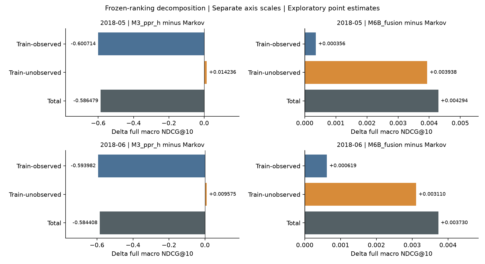

# Topology giúp phần nào và làm mất điểm ở đâu?

Phân tích bổ sung ngày 22/10/2026, trên **frozen predictions của study-v3**. Đây là post-hoc exploratory analysis, không một held-out experiment mới. Không fit lại, chọn hyperparameters hoặc thay ranking. Script xác minh published bundle trước khi tính; kiểm tra decomposition bằng stored NDCG cho từng source/model/month.

## 1. Phân rã gain theo published training history

Với mỗi nguồn, giữ nguyên full IDCG và original Top-10. Chia các future-positive targets thành hai nhóm: có published training count và không có published training count. Tổng hai phần DCG/IDCG đúng bằng full NDCG ban đầu:

\[
NDCG_u = \frac{DCG_{u,observed}}{IDCG_{u,full}}
       + \frac{DCG_{u,unobserved}}{IDCG_{u,full}}.
\]

Do giữ cùng mẫu số, chênh model–Markov cũng cộng được chính xác. **Không** tính NDCG riêng rồi normalize mỗi subgroup bằng IDCG khác; cách đó sẽ mất tính cộng. “Unobserved” không có nghĩa true zero-click hoặc một article mới.

| Month | Contrast | Δ từ train-observed targets | Δ từ train-unobserved targets | Δ toàn bộ |
|---|---|---:|---:|---:|
| May | PPR-H − Markov | −0,600714 | +0,014236 | −0,586479 |
| June | PPR-H − Markov | −0,593982 | +0,009575 | −0,584408 |
| May | Fusion − Markov | +0,000356 | +0,003938 | +0,004294 |
| June | Fusion − Markov | +0,000619 | +0,003110 | +0,003730 |



Hình bổ sung: các panels dùng **axis scales riêng**, chỉ hiển thị point estimates; CI nằm trong JSON và phần diễn giải. Không so chiều dài bars giữa panels để suy effect size.

Đây là bằng chứng mô tả rõ hơn cho câu chuyện nghiên cứu: PPR có phần đóng góp tốt hơn ở training-unobserved targets nhưng trả giá lớn trên targets đã có lịch sử. Fusion giữ được nhiều giá trị của Markov; phần lớn **point-estimate net gain** nằm ở training-unobserved targets.

Không diễn giải decomposition là causal attribution hoặc chắc chắn có improvement. Fusion unobserved-component 95% source bootstrap CI: May **[−0,001085; 0,010069]**, June **[−0,000602; 0,009139]**; đều chứa 0. Primary overall intervals cũng chứa 0. Các component intervals exploratory; không làm nhiều comparisons rồi chỉ chọn interval dương. Khoảng tin cậy của tổng không bằng tổng endpoints của các component intervals.

Một hypothesis cần kiểm tra tiếp: **phần hữu ích của topology có chủ yếu là sắp thứ tự các candidates đồng hạng theo count không?** Bảng này chưa trả lời được hoàn toàn; cần topology tie-break control và kiểm tra thứ tự giữa targets có counts khác nhau.

## 2. Phân biệt lỗi candidates và lỗi ranker

Candidate oracle dùng future counts để xếp thứ tự tốt nhất có thể **trong cùng C(u)**, rồi chấm với full IDCG. Đây là diagnostic upper bound; không model triển khai được, không dùng chọn candidates hoặc tune model.

| Month | Nguồn có labels | Candidate-oracle macro NDCG | Markov | Fusion |
|---|---:|---:|---:|---:|
| May | 127 | 0,970325 | 0,899122 | 0,903416 |
| June | 122 | 0,954363 | 0,889888 | 0,893618 |

Có decomposition thứ hai: `1 − model_NDCG = (1 − candidate_oracle) + (candidate_oracle − model_NDCG)`.

| Month | Gap do candidates tới ideal toàn labels | Ranking gap của Markov trong candidates | Ranking gap của fusion trong candidates |
|---|---:|---:|---:|
| May | 0,029675 | 0,071202 | 0,066909 |
| June | 0,045637 | 0,064474 | 0,060744 |

Bảng giúp tránh quy toàn bộ lỗi cho thuật toán. Candidate limitation tăng ở June theo observable full denominator. Nó không chứng minh nguyên nhân là graph staleness: mapping, editorial-link extraction, changing traffic và suppression cũng có thể liên quan. Candidate mass coverage và NDCG ceiling là hai đại lượng khác nhau.

## 3. Khả năng tái lập và claim review

```bash
python3 scripts/diagnose_frozen_predictions.py --output reports/extensions/mechanism-recheck
```

Thêm `--plot` trong scientific environment để sinh lại PNG/SVG. Output phải là thư mục mới; không overwrite final study. [JSON](mechanism_diagnostics.json) chứa full precision, intervals và input SHA256; [source table](source_decomposition.csv) giữ kết quả từng nguồn. Verifier tính lại 5.600 main-model evaluations trước phân tích. Decomposition kiểm tra thêm 249×3 = 747 non-NA source/model results và inequality model≤oracle.

| Claim | Evidence | Trạng thái |
|---|---|---|
| PPR có trade-off giữa hai nhóm targets | Additive decomposition, cùng full IDCG/rankings | Supported descriptively |
| Net gain fusion chủ yếu nằm ở nhóm chưa có published train count | Hai tháng point estimates | Supported descriptively; uncertainty lớn |
| Topology chắc chắn cải thiện missing-count ranking | Fusion component CI chứa 0 | **Chưa đủ bằng chứng** |
| Oracle có thể triển khai như model | Nó cần future labels | **Không hợp lệ** |
| Cần thêm controlled tie-break baseline | Hypothesis từ decomposition | Đề xuất thí nghiệm mới, chưa chạy |

Self-review: contribution là giải thích kết quả đã có; notation và mẫu số giữ nhất quán; chưa causal/confirmatory evidence; cần fresh holdout cho model cải tiến; no change to original protocol/predictions.
